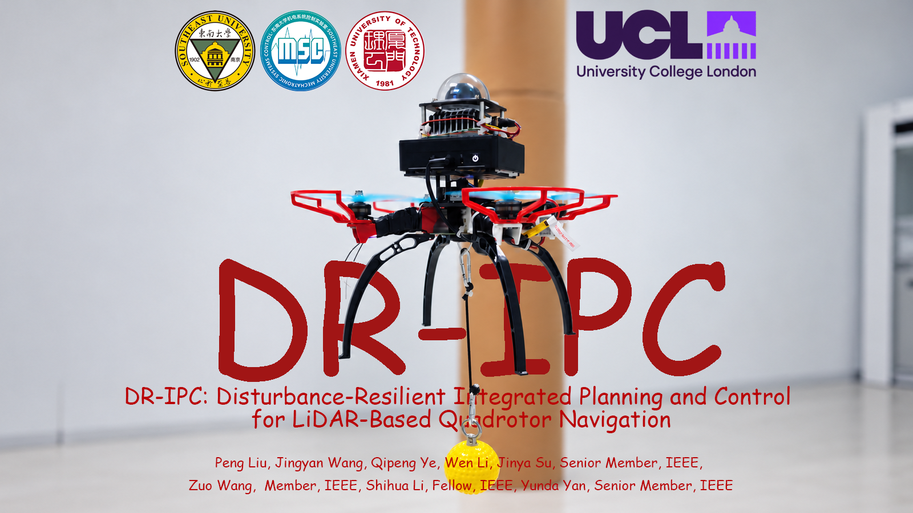
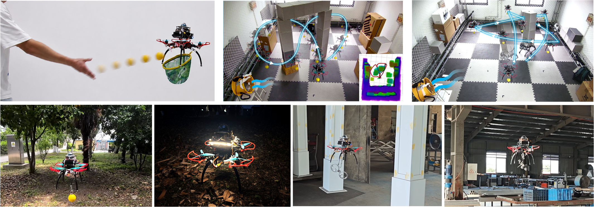

# DR-IPC

**Disturbance-Resilient Integrated Planning and Control for LiDAR-Based Quadrotor Navigation**



## Authors

Peng Liu<sup>1</sup>, Jingyan Wang<sup>1</sup>, Qipeng Ye<sup>2</sup>, Wen Li<sup>1</sup>, Jinya Su<sup>1,3</sup>, Zuo Wang<sup>1</sup>, Shihua Li<sup>1,3</sup>, and Yunda Yan<sup>4</sup>

<sup>1</sup> School of Automation, Southeast University
<sup>2</sup> Xiamen University of Technology
<sup>3</sup> Institute of Intelligent Unmanned Systems, Southeast University
<sup>4</sup> University College London

## Links

- **Project page with vedio:** https://drpp316.github.io/DR-IPC-Page/
- **Paper:** [arXiv PDF](https://arxiv.org/pdf/2610.03530)
- **Code:** [github.com/drpp316/DR_IPC](https://github.com/drpp316/DR_IPC) — **Coming soon**
- **YouTube:** [Watch the DR-IPC video playlist](https://www.youtube.com/watch?v=yp5RbyrQo2Q&list=PLB1oqUXbbHmU)
- **Bilibili:** [Watch the DR-IPC video](https://www.bilibili.com/video/BV1HaaZ6JEhW)

DR-IPC has been evaluated in simulation and real-world flight experiments. This repository includes the DR-IPC implementation and the modified MARSIM source.


 
## Experimental Demonstrations




The project page contains demonstrations of:

- Throwing-ball impact in hover
- Suspended-payload transportation with wind
- Suspended-payload transportation with a dynamic obstacle
- Outdoor flight experiments
- Outdoor flight at night
- Disturbance-resilient UAV transport in a cluttered factory

## Tested Environment

- Ubuntu 20.04
- ROS1 Noetic
- PX4 v1.13.0 for both simulation and real-world flight
- QGroundControl (QGC) v4.2.4 as the ground station
- Gazebo 11 for PX4 simulation
- Modified MARSIM source is included in this repository; no separate MARSIM download is needed.

The ROS package is `dripc`, and the main node is `dripc_node`.

## Installation

### 1. Install ROS1 Noetic

Install ROS1 Noetic on Ubuntu 20.04. You can use the FishROS one-click installer:

```shell
wget http://fishros.com/install -O fishros && . fishros
```

Select ROS1 Noetic in the installation menu.

### 2. Install PX4 v1.13.0  

DR-IPC uses [PX4 v1.13.0](https://github.com/PX4/PX4-Autopilot/tree/v1.13.0) for both simulation and real-world flight. Refer to the [XTDrone installation tutorial](https://www.yuque.com/xtdrone/manual_cn/install_scripts) for installation instructions, and select PX4 v1.13.0 when setting up the flight stack.

 
Install MAVROS and Gazebo using the XTDrone tutorial above. **Make sure to also install `mavros-extras` (`ros-noetic-mavros-extras`).**

#### QGroundControl (QGC) v4.2.4

QGroundControl is the ground station used to configure PX4. Our setup uses QGC v4.2.4:

- [Download QGC v4.2.4 for Ubuntu/Linux (AppImage)](https://github.com/mavlink/qgroundcontrol/releases/download/v4.2.4/QGroundControl.AppImage)
- [Official QGC v4.2.4 release page](https://github.com/mavlink/qgroundcontrol/releases/tag/v4.2.4)


### 3. Install the Livox MID-360 driver, FAST-LIO2   

For physical MID-360 hardware, install [Livox ROS Driver 2](https://github.com/Livox-SDK/livox_ros_driver2), including its Livox-SDK2 dependency, following the driver's ROS1 instructions.

For PX4/MID-360 integration and FAST-LIO2 configuration, refer to the following sections of [px4_gazebo_fuel_sim](https://github.com/qiurongcan/px4_gazebo_fuel_sim):

- [1 PX4+MID360配置](https://github.com/qiurongcan/px4_gazebo_fuel_sim#1-px4mid360配置)
- [2 FAST LIO2配置](https://github.com/qiurongcan/px4_gazebo_fuel_sim#2-fast-lio2配置)


Follow the tutorial's [QGC参数设置](https://github.com/qiurongcan/px4_gazebo_fuel_sim#qgc参数设置) section to configure the external localization input. Since DR-IPC uses PX4 v1.13.0, use the parameter settings listed for PX4 versions **before v1.14.0**.

### 4. Install NMPC dependencies

The NMPC implementation uses ACADO Toolkit, qpOASES, and Eigen. ACADO and Eigen must be installed separately. The qpOASES source used by DR-IPC is included in this repository and is compiled with the project.

#### ACADO Toolkit

Install ACADO following the [official Linux installation guide](https://acado.github.io/install_linux.html). The commands below follow that guide and build the stable branch:

```bash
sudo apt-get install gcc g++ cmake git gnuplot doxygen graphviz

cd ~
git clone https://github.com/acado/acado.git -b stable ACADOtoolkit
cd ~/ACADOtoolkit
mkdir -p build
cd build
cmake ..
make -j$(nproc)
```

The prerequisite list above follows the ACADO guide.  

Load the ACADO environment in each terminal used to build or run DR-IPC:

```bash
source ~/ACADOtoolkit/build/acado_env.sh
```

To load it automatically in new Bash terminals, add the command to `~/.bashrc`:

```bash
echo 'source ~/ACADOtoolkit/build/acado_env.sh' >> ~/.bashrc
source ~/.bashrc
```

#### qpOASES

The qpOASES sources are included at:

```text
dripc/external_packages/qpoases/
```

No separate qpOASES installation is required. The DR-IPC CMake configuration compiles these sources into the controller.

#### Eigen

The [NMPC upstream tutorial](https://github.com/lw-seu/quadrotor_mpc#install-dependencies) specifies Eigen 3.4 or newer. Eigen is shared by the NMPC and IPC components and only needs to be installed once. If a suitable version is already available to CMake, skip this step.

The example below installs Eigen 3.4.0 from the [official Eigen repository](https://gitlab.com/libeigen/eigen/-/tree/3.4.0):

```bash
cd ~
git clone --branch 3.4.0 --depth 1 https://gitlab.com/libeigen/eigen.git eigen-3.4.0
cd ~/eigen-3.4.0
mkdir -p build
cd build
cmake .. -DCMAKE_INSTALL_PREFIX=/usr/local -DBUILD_TESTING=OFF -DEIGEN_BUILD_DOC=OFF
sudo make install
```

Eigen is a header-only library; this step installs its headers and CMake package configuration without building a separate Eigen library. See the [official Eigen getting-started guide](https://libeigen.gitlab.io/eigen/docs-3.4/GettingStarted.html) for details.


### 5. Install IPC dependencies

The retained IPC components use Eigen, PCL, and fmt. See the [IPC upstream repository](https://github.com/hku-mars/IPC) for its original dependency notes.

Install the system libraries:

```bash
sudo apt-get install libpcl-dev libdw-dev libtbb-dev ros-noetic-rosfmt
```

**Skip OSQP and OSQP-Eigen in the IPC tutorial.** DR-IPC uses ACADO and qpOASES for NMPC, with Eigen for matrix operations.

#### fmt

Download `fmt.zip` from the [IPC v0.1 third-party release](https://github.com/hku-mars/IPC/releases/tag/v0.1), extract it, then build and install it:

```bash
unzip fmt.zip
cd fmt
mkdir -p build
cd build
cmake -DBUILD_SHARED_LIBS=TRUE ..
make -j$(nproc)
sudo make install
sudo cp /usr/local/lib/libfmt.so.8 /usr/lib
```

### 6. Build DR-IPC

#### Get the source

Clone the repository:

```bash
mkdir -p ~/dripc/src
cd ~/dripc/src
git clone https://github.com/drpp316/DR_IPC.git
```

Or select **Code → Download ZIP** on the [repository page](https://github.com/drpp316/DR_IPC). Create `~/dripc/src`, extract the ZIP there, and rename the extracted repository folder to `DR_IPC` if needed. The main package path should be `~/dripc/src/DR_IPC/dripc`.

#### Build

With ROS and ACADO set up in `~/.bashrc`, open a new Bash terminal and run the commands below. If you keep the source in another folder, replace `~/dripc` with that path.

`rosdep install` installs missing dependencies listed in `package.xml`. Complete the manual installation steps above first.

```bash
cd ~/dripc

rosdep install --from-paths src --ignore-src -r -y
catkin_make
source devel/setup.bash
```

After a successful build, run this once to load the workspace in new Bash terminals. Use the full path in `.bashrc`:

```bash
echo 'source ~/dripc/devel/setup.bash' >> ~/.bashrc
source ~/.bashrc
```

The `quadrotor_msgs` package is included at `src/DR_IPC/mars_uav_sim/mars_quadrotor_msgs` in the workspace; it does not need to be downloaded separately from IPC, NMPC, or FAST-LIO.

## How to Use

Open a separate terminal for each step and keep the earlier nodes running. Run one test at a time. The ROS package name is `dripc`.

Python tools are in `src/DR_IPC/dripc/scripts/` in the workspace. Edit the goal scripts' `GOALS` and takeoff-height settings for your test. Logs are saved to `~/.ros/dripc/logs/` by default (`$ROS_HOME/dripc/logs/` if `ROS_HOME` is set).


### 1. MARSIM simulation

This test uses the modified MARSIM source included in the repository.

**Terminal 1 — start DR-IPC:**

```bash
roslaunch dripc marsim.launch
```

**Terminal 2 — start the simulator and forest map:**

```bash
roslaunch test_interface map_rc.launch
```

**Terminal 3 — send goals:**

```bash
rosrun dripc set_multi_goals_marsim.py
```

The predefined goal sequence makes the UAV trace the letters `MSC`; edit `GOALS` in the script to change the trajectory.

You can also select a goal with the RViz `3D Goal` tool. The controller loads `src/DR_IPC/dripc/config/marsim.yaml` in the workspace.

### 2. Sudden-obstacle simulation (optional)

This additional MARSIM example tests sudden-obstacle avoidance. Run the following launch files in two terminals:

```bash
roslaunch dripc avoid.launch
roslaunch dripc fast_avoid.launch
```

The test sends its own goal. Its obstacle and goal settings are in `src/DR_IPC/dripc/launch/fast_avoid.launch`.

### 3. Gazebo + PX4 simulation

Set up PX4, the MID-360 Gazebo plugin, and FAST-LIO2 using the installation links above. Reference PX4 launch, UAV model, and world files are provided at:

```text
dripc/scripts/How2Use/gazebo/gazebo world/
├── px4 launch/
├── uav model/
└── world/
```

These files include MID-360 and suspended-payload models, together with several scene and wind-field worlds. They are provided as references for adapting a PX4/Gazebo setup; detailed integration instructions are not included here.

**Terminal 1 — start PX4 and Gazebo:**

Use the shell script (recommended):

```bash
bash ~/dripc/src/DR_IPC/dripc/scripts/px4.sh
```

Or launch directly:

```bash
roslaunch px4 lidar_sim.launch
```

`px4.sh` stops existing ROS, PX4 SITL, and Gazebo processes, then launches the default setup. Open QGC after PX4 starts if ground-station monitoring is needed.

**Terminal 2 — start FAST-LIO2:**

```bash
roslaunch fast_lio mapping_mid360.launch
```

PX4 must receive FAST-LIO2 position data as described in the setup tutorial. If your setup has no position bridge running, start the bridge below in another terminal:

```bash
rosrun dripc fastlio_to_px4_position.py
```

**Terminal 3 — start DR-IPC:**

```bash
roslaunch dripc gazebo.launch
```

**Terminal 4 — arm and enter OFFBOARD in simulation:**

```bash
rosrun dripc arm_offboard.py
```

**Option 1 — select a goal with the mouse:**

Select the `3D Goal` tool in RViz and click a target position.

**Or, option 2 — send goals with a script:**

Run in another terminal:

```bash
rosrun dripc set_multi_goals_gazebo.py
```

The controller loads `src/DR_IPC/dripc/config/gazebo.yaml` in the workspace.

### 4. Real-world flight

**Real-flight tutorial video:** Coming soon.

The transmitter layout and RC channel mapping used in our experiments are shown below for reference. Both figures are stored in `dripc/scripts/How2Use/real flight/`.

<p align="center">
  
</p>


Adapt the channel mapping to your own transmitter and verify every switch before flight. To practise the Manual, Command, Hover, and Land switching logic safely in Gazebo, run:

```bash
rosrun dripc rc_mode_tester.py
```

Use `m`, `c`, `h`, and `l` to simulate the corresponding switches; press `q` to quit.

Match `src/DR_IPC/dripc/config/real.yaml` and the RC switch mapping to your aircraft before flight. Keep QGC closed during the startup below, as in the NUC setup notes.

**Terminal 1 — start the MID-360 driver, FAST-LIO2, and MAVROS:**

```bash
bash ~/fastlio2/0start_fastlio_and_marvros.sh
```

This is the external startup script used on our NUC. It is not included in this repository; replace its path with your own startup script.

**Terminal 2 — send FAST-LIO2 position data to PX4:**

```bash
rosrun dripc fastlio_to_px4_position.py
```

The bridge uses `/Odometry` by default and shows the FAST-LIO2 and PX4 positions.

**Terminal 3 — start DR-IPC:**

```bash
roslaunch dripc real.launch
```


Use the configured RC switches to enter OFFBOARD and the controller's Command mode. Check for `[MPC FSM]: Manual or Hover --> Command.` in the controller terminal. After the vehicle is hovering, send the goals.

**Terminal 4 — send flight goals:**

```bash
rosrun dripc set_multi_goals_real.py
```


## Upstream Projects

DR-IPC builds on or uses software and methods from the following projects:

- [IPC](https://github.com/hku-mars/IPC)
- [Quadrotor MPC / NMPC](https://github.com/lw-seu/quadrotor_mpc)
- [ACADO Toolkit](https://github.com/acado/acado)
- [qpOASES](https://github.com/coin-or/qpOASES)
- [Eigen](https://gitlab.com/libeigen/eigen)
- [PX4 Autopilot v1.13.0](https://github.com/PX4/PX4-Autopilot/tree/v1.13.0)
- [MAVROS](https://github.com/mavlink/mavros)
- [FAST-LIO](https://github.com/hku-mars/FAST_LIO)

Please also consult the upstream projects' documentation for their licenses, dependency requirements, and installation details.

See [THIRD_PARTY_NOTICES.md](THIRD_PARTY_NOTICES.md) for source credits. The license for DR-IPC's own additions is still being selected; see [release status](docs/RELEASE_STATUS.md).


## Citation

```bibtex
@article{liu2026dripc,
  title  = {DR-IPC: Disturbance-Resilient Integrated Planning and Control for LiDAR-Based Quadrotor Navigation},
  author = {Liu, Peng and Wang, Jingyan and Ye, Qipeng and Li, Wen and Su, Jinya and Wang, Zuo and Li, Shihua and Yan, Yunda},
  year   = {2026}
}
```
